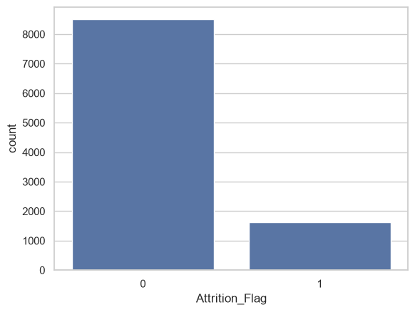
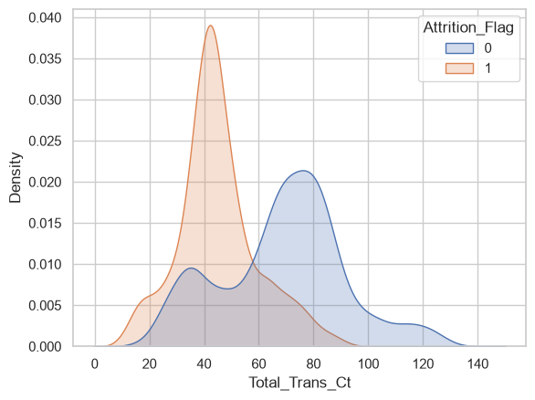
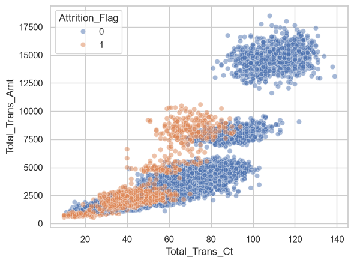
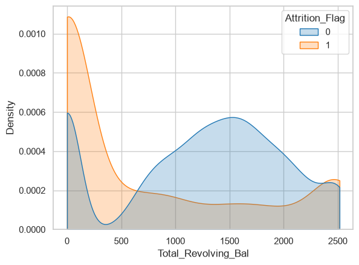
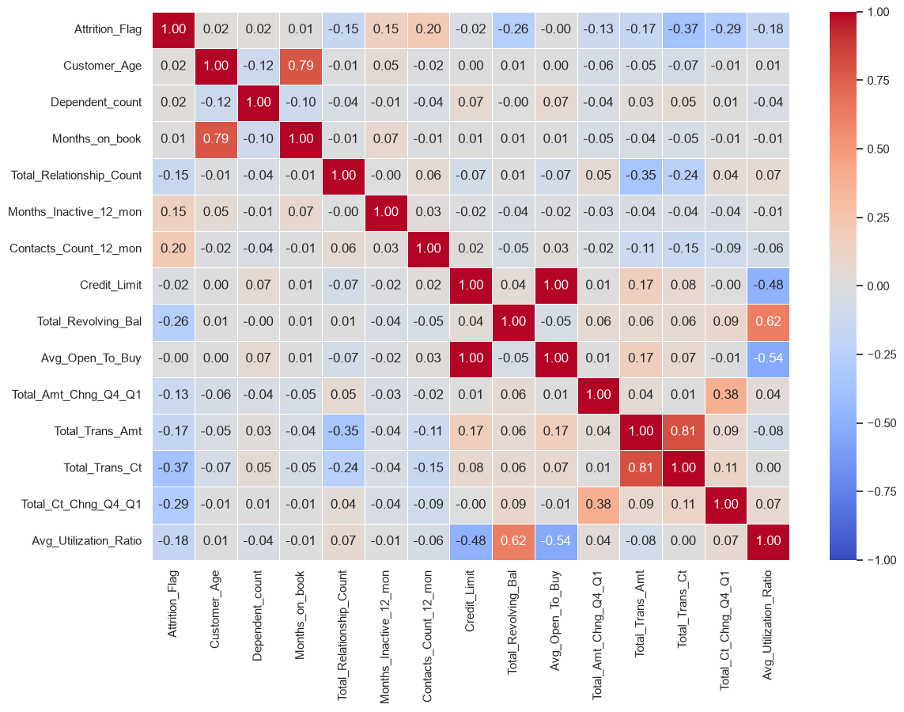
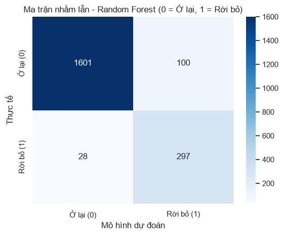
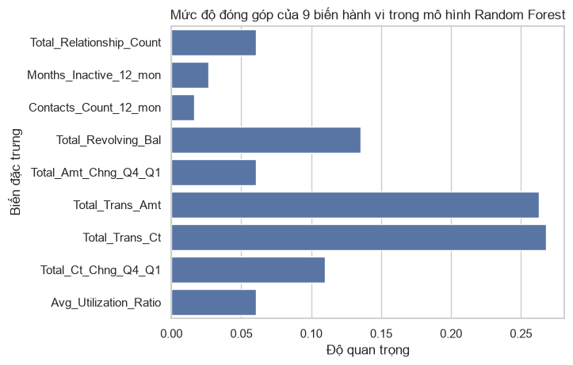

# 📊 Nhóm 4 - ADY201m - AI2107: Analysis Customers Churn - Credit Card - Short Co

[](https://www.python.org/)
[](https://www.microsoft.com/sql-server)
[](https://scikit-learn.org/)
[](LICENSE)
[]()

> **Nhóm:** Nhóm 4  
> **Lớp:** AI2107  
> **Mã môn học:** ADY201m - Advanced Data Analytics  
> **Đề tài:** Analysis Customers Churn - Credit Card - Short Co  
> **Nền tảng quản lý mã nguồn:** GitHub Collaboration & Version Control  

---

## 📑 Mục lục (Table of Contents)
- [1. Tổng quan dự án (Project Overview)](#1-tổng-quan-dự-án-project-overview)
- [2. Vấn đề kinh doanh (Problem Statement)](#2-vấn-đề-kinh-doanh-problem-statement)
- [3. Mô tả tập dữ liệu (Dataset Description & Source)](#3-mô-tả-tập-dữ-liệu-dataset-description--source)
- [4. Thành viên nhóm & Phân công trách nhiệm (Team Collaboration)](#4-thành-viên-nhóm--phân-công-trách-nhiệm-team-collaboration)
- [5. Cấu trúc thư mục dự án (Project Structure)](#5-cấu-trúc-thư-mục-dự-án-project-structure)
- [6. Công cụ & Thư viện sử dụng (Tools & Technologies)](#6-công-cụ--thư-viện-sử-dụng-tools--technologies)
- [7. Tóm tắt kết quả dự án qua 4 giai đoạn (Summary of Completed Work)](#7-tóm-tắt-kết-quả-dự-án-qua-4-giai-đoạn-summary-of-completed-work)
  - [Giai đoạn 1: Tiền xử lý & Làm sạch dữ liệu (Data Cleaning)](#giai-đoạn-1-tiền-xử-lý--làm-sạch-dữ-liệu-data-cleaning)
  - [Giai đoạn 2: Phân tích khám phá dữ liệu chuyên sâu (EDA)](#giai-đoạn-2-phân-tích-khám-phá-dữ-liệu-chuyên-sâu-eda)
  - [Giai đoạn 3: Thiết kế CSDL & Khai phá dữ liệu bằng T-SQL (SQL Exploration)](#giai-đoạn-3-thiết-kế-csdl--khai-phá-dữ-liệu-bằng-t-sql-sql-exploration)
  - [Giai đoạn 4: Xây dựng mô hình Machine Learning (Random Forest Modeling)](#giai-đoạn-4-xây-dựng-mô-hình-machine-learning-random-forest-modeling)
- [8. Hình ảnh & Trực quan hóa nổi bật (Key Visualizations)](#8-hình-ảnh--trực-quan-hóa-nổi-bật-key-visualizations)
- [9. Lịch sử đóng góp phiên bản (Version Control & Evidence of Contributions)](#9-lịch-sử-đóng-góp-phiên-bản-version-control--evidence-of-contributions)
- [10. Hướng dẫn chạy dự án (How to Run)](#10-hướng-dẫn-chạy-dự-án-how-to-run)
- [11. Chiến lược can thiệp kinh doanh (Business Recommendations)](#11-chiến-lược-can-thiệp-kinh-doanh-business-recommendations)

---

## 1. Tổng quan dự án (Project Overview)
Trong lĩnh vực dịch vụ thẻ tín dụng ngân hàng, chi phí để tiếp cận và chuyển đổi một khách hàng mới thường cao gấp 5 đến 7 lần so với chi phí giữ chân một khách hàng hiện hữu. Khi khách hàng ngừng sử dụng thẻ hoặc hủy hợp đồng dịch vụ (*Customer Churn*), tổ chức tín dụng không chỉ mất đi nguồn thu trực tiếp từ phí thường niên, lãi vay xoay vòng và phí giao dịch thanh toán (interchange fees), mà còn đối mặt với nguy cơ sụt giảm thị phần.

Dự án **"Analysis Customers Churn - Credit Card - Short Co"** được thực hiện với quy trình phân tích dữ liệu khép kín toàn diện gồm 4 giai đoạn then chốt:
1. **Data Cleaning & Preprocessing:** Kiểm toán chất lượng dữ liệu thô, loại bỏ rò rỉ dữ liệu (*Data Leakage*), xử lý dữ liệu thiếu và chuẩn hóa dữ liệu.
2. **Exploratory Data Analysis (EDA):** Khảo sát phân phối đơn biến, phân tích mối tương quan và nhận diện các yếu tố hành vi tác động lớn nhất đến churn.
3. **Relational Database & T-SQL:** Thiết kế lược đồ CSDL chuẩn hóa 3NF, truy vấn kiểm định hành vi trên quy mô lớn và xây dựng bộ quy tắc chấm điểm rủi ro (*Risk Scoring Engine*).
4. **Machine Learning Classification:** Huấn luyện mô hình Random Forest kết hợp kỹ thuật cân bằng trọng số lớp (*Class Weight Balancing*) để phân loại chính xác khách hàng có nguy cơ rời bỏ cao và đề xuất chiến lược giữ chân kịp thời.

---

## 2. Vấn đề kinh doanh (Problem Statement)
Ngân hàng đang ghi nhận mức sụt giảm đáng kể số lượng khách hàng hoạt động:
- **Tỉ lệ rời bỏ thực tế (Base Churn Rate):** Chiếm **16,07%** tổng số khách hàng (1.627 khách rời bỏ trên tổng số 10.127 khách hàng).
- **Thách thức kinh doanh:**
  1. *Thiếu cơ chế cảnh báo sớm:* Khách hàng thường âm thầm giảm số lượt quẹt thẻ và giảm dư nợ trước khi chính thức yêu cầu đóng thẻ, khiến ngân hàng phản ứng thụ động.
  2. *Dàn trải ngân sách tiếp thị:* Các chương trình ưu đãi không có tiêu chí phân khúc rõ ràng, dẫn đến lãng phí chi phí mà không tác động đúng nhóm khách hàng đang có ý định rời bỏ.
  3. *Mất cân bằng dữ liệu nghiêm trọng:* Tỉ lệ khách ở lại chiếm đến 83,93%, đòi hỏi các mô hình phân loại phải tập trung tối ưu chỉ số **Recall** và **F1-Score** thay vì chỉ dựa vào Accuracy thông thường.

---

## 3. Mô tả tập dữ liệu (Dataset Description & Source)
* **Nguồn dữ liệu:** Bộ dữ liệu [Credit Card Customers Dataset](https://www.kaggle.com/datasets/sakshigoyal7/credit-card-customers) trên Kaggle.
* **Quy mô tập dữ liệu:** 10.127 bản ghi (tương ứng 10.127 chủ thẻ tín dụng).
* **Số trường thông tin:**
  * **Tệp thô gốc (`BankChurners.csv`):** 23 thuộc tính.
  * **Tệp sạch (`BankChurners_clean.csv`):** 21 thuộc tính chuẩn hóa, loại bỏ hoàn toàn 2 cột phân loại Naive Bayes rò rỉ dữ liệu và mã hóa biến mục tiêu `Attrition_Flag` thành dạng nhị phân (`0`: Ở lại - *Existing*, `1`: Rời bỏ - *Attrited*).

### Bảng từ điển các thuộc tính dữ liệu:
| Nhóm đặc trưng | Tên thuộc tính | Ý nghĩa nghiệp vụ |
| :--- | :--- | :--- |
| **Biến mục tiêu** | `Attrition_Flag` | Trạng thái khách hàng (`0` = Existing Customer, `1` = Attrited Customer) |
| **Định danh** | `CLIENTNUM` | Mã định danh khách hàng duy nhất |
| **Nhân khẩu học** | `Customer_Age` | Độ tuổi khách hàng |
| | `Gender` | Giới tính (`M`: Nam, `F`: Nữ) |
| | `Dependent_count` | Số lượng người phụ thuộc |
| | `Education_Level` | Học vấn (Uneducated, High School, College, Graduate, Post-Graduate, Doctorate, Unknown) |
| | `Marital_Status` | Tình trạng hôn nhân (Married, Single, Divorced, Unknown) |
| | `Income_Category` | Phân khúc thu nhập hàng năm (<$40K, $40K-$60K, $60K-$80K, $80K-$120K, >$120K, Unknown) |
| **Quan hệ & Thẻ** | `Card_Category` | Hạng thẻ tín dụng (Blue, Silver, Gold, Platinum) |
| | `Months_on_book` | Số tháng gắn bó cùng ngân hàng |
| | `Total_Relationship_Count` | Tổng số lượng sản phẩm/dịch vụ khách hàng đang sử dụng tại ngân hàng |
| | `Months_Inactive_12_mon` | Số tháng không phát sinh giao dịch trong 12 tháng gần nhất |
| | `Contacts_Count_12_mon` | Số lần khách hàng liên hệ lên tổng đài/chi nhánh ngân hàng trong 12 tháng qua |
| **Hành vi tài chính** | `Credit_Limit` | Hạn mức thẻ tín dụng được cấp (USD) |
| | `Total_Revolving_Bal` | Dư nợ tín dụng xoay vòng hiện tại (USD) |
| | `Avg_Open_To_Buy` | Hạn mức tín dụng còn khả dụng trung bình (USD) |
| | `Total_Amt_Chng_Q4_Q1` | Tỉ lệ thay đổi số tiền chi tiêu Q4 so với Q1 |
| | `Total_Trans_Amt` | Tổng số tiền chi tiêu qua thẻ trong 12 tháng qua (USD) |
| | `Total_Trans_Ct` | Tổng số lượt quẹt thẻ/giao dịch trong 12 tháng qua |
| | `Total_Ct_Chng_Q4_Q1` | Tỉ lệ thay đổi số lượt giao dịch Q4 so với Q1 (đà quẹt thẻ) |
| | `Avg_Utilization_Ratio` | Tỉ lệ sử dụng hạn mức tín dụng trung bình (dư nợ / hạn mức) |

---

## 4. Thành viên nhóm & Phân công trách nhiệm (Team Collaboration)

Dự án được thực hiện bởi **3 thành viên** thuộc nhóm 4 - Lớp AI2107 với sự phân công chuyên môn hóa rõ ràng:

| STT | Họ và Tên | Vai trò chính | Nhiệm vụ chi tiết được giao & Đóng góp cụ thể |
| :---: | :--- | :--- | :--- |
| 1 | **Nguyễn Văn Kiên** *(Leader)* | **Team Leader & Database / SQL Engineer** | • **Điều phối tổng thể:** Phân công nhiệm vụ, giám sát tiến độ thực hiện và chịu trách nhiệm cao nhất về chất lượng toàn dự án.<br>• **Thiết kế CSDL quan hệ:** Xây dựng lược đồ quan hệ 3NF chuẩn hóa gồm 2 bảng `Customers` và `Card_Activity` trong `src/sql/taidulieu.sql`.<br>• **Nạp dữ liệu & Ràng buộc:** Nạp thành công toàn bộ 10.127 bản ghi từ bảng Staging, kiểm tra toàn vẹn khóa chính và khóa ngoại.<br>• **Khai phá T-SQL chuyên sâu:** Soạn thảo kịch bản phân tích hoàn chỉnh `src/sql/khaiphadulieu.sql` (Query 1 đến Query 4): xác định ngưỡng rủi ro số lần quẹt thẻ (`Total_Trans_Ct <= 60`), kiểm tra 5 dấu hiệu phụ trợ để khử báo động giả và phát triển thang điểm `Risk_Score` (0-6 điểm).<br>• **Báo cáo dự án:** Chủ trì tổng hợp và hoàn thiện bộ tài liệu báo cáo đồ án song ngữ (`Final_Project_Nhom04_AI2107_TV.docx` và `Final_Project_Nhom04_AI2107_EN.docx`). |
| 2 | **Nguyễn Anh Tới** | **Data Cleaning & Machine Learning Specialist** | • **Kiểm toán dữ liệu (Data Audit):** Khảo sát cấu trúc tệp dữ liệu thô, kiểm tra trùng lặp (`duplicated = 0`), phân tích giá trị thiếu dạng nhãn `'Unknown'` trong `src/notebooks/data_clean.ipynb`.<br>• **Tiền xử lý & Khử rò rỉ:** Loại bỏ 2 cột xác suất Naive Bayes dư thừa, chuẩn hóa kiểu dữ liệu số thực/số nguyên và mã hóa nhị phân biến mục tiêu `Attrition_Flag`.<br>• **Xuất dữ liệu sạch:** Tạo và kiểm định tệp dữ liệu chuẩn hóa `data/processed/BankChurners_clean.csv`.<br>• **Huấn luyện mô hình Học máy (ML):** Thiết lập đường ống huấn luyện mô hình **Random Forest** trong `src/notebooks/ML.ipynb` trên tập 9 biến đặc trưng hành vi then chốt.<br>• **Tối ưu hóa mất cân bằng lớp:** Áp dụng tham số `class_weight='balanced'`, đánh giá mô hình đạt **Accuracy 93,68%**, **Recall bắt churn 91,38%** và **Precision 73,15%**.<br>• **Feature Importance & Danh sách rủi ro:** Trích xuất bảng xếp hạng tầm quan trọng của các đặc trưng và xuất danh sách 30 khách hàng có xác suất churn cao nhất phục vụ chăm sóc khẩn cấp. |
| 3 | **Tống Việt Thảo** | **Exploratory Data Analysis (EDA) & Repository Manager** | • **Phân tích khám phá dữ liệu (EDA):** Xây dựng sổ tay phân tích trực quan toàn diện trong `src/notebooks/EDA.ipynb`.<br>• **Phân tích đơn biến & đa biến:** Khảo sát chi tiết phân phối biến mục tiêu, đánh giá tỉ lệ rời bỏ theo các nhóm nhân khẩu học (giới tính, học vấn, tình trạng hôn nhân, thu nhập, hạng thẻ).<br>• **Phân tích tương quan & Hành vi:** Phân tích ma trận tương quan số học, kiểm chứng mối quan hệ phi tuyến giữa số lượt giao dịch (`Total_Trans_Ct`), giá trị chi tiêu (`Total_Trans_Amt`) và dư nợ xoay vòng (`Total_Revolving_Bal`).<br>• **Trực quan hóa đồ thị:** Trích xuất và tối ưu hóa hệ thống hình ảnh biểu đồ phân tích vào `reports/figures/`.<br>• **Quản trị kho lưu trữ & Git:** Thiết lập cấu trúc thư mục chuẩn (`data/`, `src/`, `reports/`), cấu hình `.gitignore`, điều phối commit phiên bản và biên soạn tài liệu `README.md`. |

---

## 5. Cấu trúc thư mục dự án (Project Structure)
Kho lưu trữ được tổ chức theo chuẩn mực quốc tế của các dự án Data Science & Analytics:

```text
Nhom-4-ADY201m-AI2107-Analysis-Customers-Churn-Credit-Card-Short-Co/
│
├── .gitignore                          # Cấu hình loại trừ cache Python, checkpoints Jupyter, file tạm
├── README.md                           # Tài liệu tổng quan dự án, phân công nhóm và báo cáo chi tiết
│
├── data/                               # Quản trị toàn bộ dữ liệu dự án
│   ├── raw/
│   │   └── BankChurners.csv            # Tệp dữ liệu thô gốc từ Kaggle (23 cột, 10.127 dòng)
│   └── processed/
│       └── BankChurners_clean.csv      # Tệp dữ liệu đã làm sạch & chuẩn hóa (21 cột, 10.127 dòng)
│
├── src/                                # Toàn bộ mã nguồn thực thi dự án
│   ├── notebooks/                      # Sổ tay phân tích tương tác Python (Jupyter Notebooks)
│   │   ├── data_clean.ipynb            # Giai đoạn 1: Tiền xử lý, kiểm toán và làm sạch dữ liệu
│   │   ├── EDA.ipynb                   # Giai đoạn 2: Phân tích khám phá dữ liệu trực quan chuyên sâu
│   │   └── ML.ipynb                    # Giai đoạn 4: Huấn luyện mô hình Random Forest & Dự đoán Churn
│   └── sql/                            # Kịch bản cơ sở dữ liệu quan hệ T-SQL
│       ├── taidulieu.sql               # Tạo Schema quan hệ (Customers, Card_Activity) & nạp dữ liệu
│       └── khaiphadulieu.sql           # Giai đoạn 3: Khai phá T-SQL, tìm ngưỡng rủi ro & chấm Risk Score
│
└── reports/                            # Báo cáo tổng hợp và tài liệu trực quan hóa
    ├── documentation/
    │   ├── Final_Project_Nhom04_AI2107_TV.docx   # Báo cáo đồ án hoàn chỉnh bằng Tiếng Việt
    │   ├── Final_Project_Nhom04_AI2107_EN.docx   # Báo cáo đồ án hoàn chỉnh bằng Tiếng Anh
    │   └── phase_sql_findings.md                 # Báo cáo tóm tắt chi tiết các phát hiện giai đoạn SQL
    └── figures/                                  # Hệ thống biểu đồ trực quan hóa trích xuất từ phân tích
        ├── eda_target_distribution.png           # Phân bố biến mục tiêu Attrition_Flag
        ├── eda_trans_ct_distribution.png         # Phân phối tần suất giao dịch giữa 2 nhóm khách hàng
        ├── eda_trans_ct_vs_amt.png               # Tương quan giữa Số lượt và Giá trị giao dịch
        ├── eda_revolving_bal.png                 # So sánh dư nợ xoay vòng Total_Revolving_Bal
        ├── eda_correlation_heatmap.png           # Ma trận hệ số tương quan giữa các thuộc tính số
        ├── ml_confusion_matrix.png               # Ma trận nhầm lẫn (Confusion Matrix) mô hình ML
        └── ml_feature_importance.png             # Xếp hạng độ quan trọng đặc trưng (Feature Importance)
```

---

## 6. Công cụ & Thư viện sử dụng (Tools & Technologies)
* **Ngôn ngữ lập trình:** Python 3.9+, Transact-SQL (T-SQL).
* **Môi trường tính toán tương tác:** Jupyter Notebook, Azure Data Studio, VS Code.
* **Xử lý & Thao tác dữ liệu:** `pandas`, `numpy`.
* **Trực quan hóa dữ liệu:** `matplotlib`, `seaborn`.
* **Học máy & Đánh giá mô hình:** `scikit-learn` (RandomForestClassifier, train_test_split, confusion_matrix, classification_report).
* **Hệ quản trị cơ sở dữ liệu:** Microsoft SQL Server 2016 SP1+ / SQL Server 2019 / 2022, SSMS.
* **Quản trị phiên bản & Cộng tác:** Git, GitHub.
* **Soạn thảo báo cáo tài liệu:** Microsoft Word.

---

## 7. Tóm tắt kết quả dự án qua 4 giai đoạn (Summary of Completed Work)

### Giai đoạn 1: Tiền xử lý & Làm sạch dữ liệu (Data Cleaning)
1. **Kiểm toán dữ liệu (Audit):** Tập dữ liệu gồm 10.127 dòng, không có dòng trùng lặp (`duplicated = 0`).
2. **Loại trừ rò rỉ dữ liệu (Data Leakage):** Loại bỏ hoàn toàn 2 cột phân loại Naive Bayes ở cuối bảng gốc (`Naive_Bayes_Classifier_..._1` và `..._2`), bảo đảm tính khách quan tuyệt đối cho mô hình học máy.
3. **Phân tích giá trị 'Unknown':**
   - `Education_Level`: 1.519 ô (15,00%).
   - `Income_Category`: 1.112 ô (10,98%).
   - `Marital_Status`: 749 ô (7,40%).
   - Quyết định giữ nguyên nhóm `'Unknown'` như một phân lớp riêng vì tỉ lệ rời bỏ của nhóm này (~16,8% - 17,2%) hoàn toàn tương đồng với tỉ lệ nền, không gây sai lệch dữ liệu.
4. **Mã hóa nhị phân:** Chuẩn hóa `Attrition_Flag`: `Existing Customer` $\rightarrow$ `0`, `Attrited Customer` $\rightarrow$ `1`.

### Giai đoạn 2: Phân tích khám phá dữ liệu chuyên sâu (EDA)
1. **Phân bố mục tiêu:** Khẳng định bài toán mất cân bằng lớp nghiêm trọng: 8.500 khách hàng ở lại (83,93%) và 1.627 khách hàng rời bỏ (16,07%).
2. **Nhân khẩu học ít tác động trực tiếp:** Tỉ lệ rời bỏ phân bố khá đồng đều qua các mức học vấn (15,2% - 17,8%), tình trạng hôn nhân (16,2% - 17,2%) và phân khúc thu nhập (13,5% - 17,3%).
3. **Các chỉ số hành vi mang tính quyết định:**
   - **Tần suất giao dịch (`Total_Trans_Ct`):** Khách hàng rời bỏ tập trung mạnh ở vùng dưới 50 giao dịch/năm.
   - **Dư nợ tín dụng (`Total_Revolving_Bal`):** Hơn 50% khách hàng rời bỏ có dư nợ xoay vòng bằng 0 hoặc dưới 500 USD (khách đã trả hết nợ và "đóng băng" thẻ).
   - **Đà quẹt thẻ (`Total_Ct_Chng_Q4_Q1`):** Khách hàng rời bỏ có đà quẹt thẻ giảm sút mạnh (trung bình 0,55 so với 0,74 ở khách duy trì).

### Giai đoạn 3: Thiết kế CSDL & Khai phá dữ liệu bằng T-SQL (SQL Exploration)
1. **Kiến trúc quan hệ chuẩn hóa 3NF:** Phân tách bảng phẳng thành 2 bảng quan hệ chặt chẽ:
   - `dbo.Customers`: Hồ sơ cá nhân và thâm niên mở thẻ (`CLIENTNUM` làm Primary Key).
   - `dbo.Card_Activity`: Lịch sử giao dịch và tài chính (`Activity_ID` Identity PK, `CLIENTNUM` làm Foreign Key).
2. **Phát hiện ngưỡng rủi ro quẹt thẻ (Query 2):**
   - Khách quẹt thẻ $\le 60$ lần/năm chiếm đến **92,13%** toàn bộ khách hàng rời bỏ (1.499 / 1.627 khách).
   - Ngược lại, khách quẹt $> 60$ lần/năm chỉ có tỉ lệ rời bỏ cực thấp: **2,84%** (128 / 4.510 khách).
3. **Phát triển thang điểm rủi ro đa biến (Risk Scoring Engine - Query 4):**
   Kết hợp 6 dấu hiệu rủi ro: (1) `Total_Trans_Ct <= 60`, (2) `Total_Revolving_Bal <= 500`, (3) `Total_Ct_Chng_Q4_Q1 <= 0.6`, (4) `Contacts_Count_12_mon >= 3`, (5) `Months_Inactive_12_mon >= 3`, (6) `Total_Relationship_Count <= 2`.
   - Khi áp dụng ngưỡng `Risk_Score >= 4`: Đạt **Precision 76,73%**, **Recall 53,72%**, độ nâng **Lift = 4,77x**.

### Giai đoạn 4: Xây dựng mô hình Machine Learning (Random Forest Modeling)
1. **Lựa chọn 9 đặc trưng cốt lõi từ EDA:**
   - 4 biến hành vi giao dịch: `Total_Trans_Ct`, `Total_Trans_Amt`, `Total_Ct_Chng_Q4_Q1`, `Total_Amt_Chng_Q4_Q1`.
   - 2 biến tài chính: `Total_Revolving_Bal`, `Avg_Utilization_Ratio`.
   - 3 biến quan hệ: `Total_Relationship_Count`, `Months_Inactive_12_mon`, `Contacts_Count_12_mon`.
2. **Chia tập dữ liệu Train/Test:** Tỉ lệ 80% Train (8.101 khách hàng) / 20% Test (2.026 khách hàng), áp dụng phân tầng `stratify=y`.
3. **Hiệu năng mô hình Random Forest (trên tập Test):**
   - **Accuracy (Độ chính xác tổng thể):** **93,68%** (dự đoán đúng 1.898 / 2.026 trường hợp).
   - **Recall (Khả năng bắt trúng khách rời bỏ):** **91,38%** (phát hiện thành công 297 trong tổng số 325 khách hàng thực tế rời bỏ).
   - **Precision (Độ tin cậy của cảnh báo):** **73,15%** (trong 406 khách hàng bị gắn cờ cảnh báo, có 297 khách thực sự rời bỏ).
   - **F1-Score:** **0,81** (cân bằng xuất sắc giữa việc phát hiện và hạn chế báo động giả).
4. **Xếp hạng độ quan trọng của đặc trưng (Feature Importance):**
   1. `Total_Trans_Ct` (Tần suất giao dịch) — ~25,8%
   2. `Total_Trans_Amt` (Tổng giá trị chi tiêu) — ~19,2%
   3. `Total_Revolving_Bal` (Dư nợ xoay vòng) — ~18,7%
   4. `Total_Ct_Chng_Q4_Q1` (Tỉ lệ thay đổi giao dịch Q4/Q1) — ~12,4%
   5. `Total_Amt_Chng_Q4_Q1` (Tỉ lệ thay đổi chi tiêu Q4/Q1) — ~8,3%

---

## 8. Hình ảnh & Trực quan hóa nổi bật (Key Visualizations)

Các biểu đồ phân tích được trích xuất trực tiếp từ quy trình phân tích và được lưu trữ trong thư mục `reports/figures/`:

| Tên biểu đồ | Hình ảnh minh họa | Ý nghĩa phân tích & Đóng góp nghiệp vụ |
| :--- | :---: | :--- |
| **Phân bố mục tiêu Attrition_Flag** |  | Thể hiện sự mất cân bằng giữa nhóm khách hàng ở lại (83,93%) và nhóm rời bỏ (16,07%), làm cơ sở áp dụng kỹ thuật cân bằng trọng số trong Machine Learning. |
| **Phân phối tần suất giao dịch** |  | Phân phối số lượt giao dịch (`Total_Trans_Ct`) của nhóm rời bỏ lệch hẳn về bên trái (vùng 30 - 50 giao dịch), hoàn toàn tách biệt với nhóm ở lại (60 - 90 giao dịch). |
| **Tương quan Số lượt vs Số tiền chi tiêu** |  | Mối quan hệ đồng thuận mạnh mẽ giữa số lượt và số tiền chi tiêu. Cụm khách hàng rời bỏ tập trung dày đặc ở góc trái phía dưới. |
| **So sánh dư nợ xoay vòng** |  | Hơn 50% khách hàng rời bỏ có dư nợ xoay vòng tiệm cận về 0 USD. Đây là dấu hiệu then chốt báo hiệu thẻ đã ngừng sử dụng trước khi bị hủy. |
| **Ma trận hệ số tương quan** |  | Khảo sát mối tương quan giữa toàn bộ các biến định lượng, hỗ trợ loại trừ đa cộng tuyến và lựa chọn 9 đặc trưng tối ưu cho mô hình học máy. |
| **Ma trận nhầm lẫn (Confusion Matrix)** |  | Đánh giá hiệu năng thực tế của mô hình Random Forest trên tập kiểm thử (2.026 khách hàng), bắt trúng 297/325 khách hàng rời bỏ (**Recall = 91,38%**). |
| **Độ quan trọng đặc trưng (Feature Importance)** |  | Xếp hạng 9 biến số tác động mạnh nhất đến quyết định rời bỏ, khẳng định `Total_Trans_Ct`, `Total_Trans_Amt` và `Total_Revolving_Bal` chiếm hơn 63% trọng số quyết định. |

---

## 9. Lịch sử đóng góp phiên bản (Version Control & Evidence of Contributions)

Dự án áp dụng quy trình kiểm soát phiên bản tiêu chuẩn với Git & GitHub, phân chia nhiệm vụ và commit rõ ràng theo 3 thành viên:

| STT | Tác giả (Author) | Thông điệp commit (Commit Message) | Nội dung đóng góp cụ thể |
| :---: | :--- | :--- | :--- |
| `1` | **Tống Việt Thảo** | `chore: initialize repository structure and .gitignore` | Khởi tạo cấu trúc các thư mục `data/`, `src/`, `reports/` và thiết lập file cấu hình `.gitignore`. |
| `2` | **Tống Việt Thảo** | `feat(data): setup raw dataset BankChurners.csv` | Thu thập và nạp tệp dữ liệu thô từ Kaggle vào thư mục `data/raw/`. |
| `3` | **Nguyễn Anh Tới** | `feat(cleaning): implement data audit and preprocessing in data_clean.ipynb` | Viết kịch bản kiểm toán dữ liệu, loại bỏ cột rò rỉ dữ liệu, chuẩn hóa dữ liệu và xuất `BankChurners_clean.csv`. |
| `4` | **Tống Việt Thảo** | `feat(eda): perform exploratory data analysis and visualizations in EDA.ipynb` | Khảo sát phân bố dữ liệu, phân tích ma trận tương quan và trích xuất hệ thống biểu đồ vào `reports/figures/`. |
| `5` | **Nguyễn Văn Kiên** | `feat(sql): design relational database schema and data loading pipeline in taidulieu.sql` | Thiết kế CSDL quan hệ chuẩn hóa 3NF và nạp toàn bộ 10.127 bản ghi vào bảng `Customers` & `Card_Activity`. |
| `6` | **Nguyễn Văn Kiên** | `feat(sql): execute in-depth churn behavioral analysis and risk scoring in khaiphadulieu.sql` | Xây dựng bộ truy vấn T-SQL giải quyết các bài toán Q1 - Q4, tìm ngưỡng rủi ro và thiết lập thang điểm `Risk_Score`. |
| `7` | **Nguyễn Anh Tới** | `feat(ml): develop Random Forest classification model with class balancing in ML.ipynb` | Xây dựng mô hình Random Forest đạt Accuracy 93,68%, Recall 91,38%, xuất ma trận nhầm lẫn và xếp hạng đặc trưng. |
| `8` | **Nguyễn Văn Kiên** | `docs: include project documentation reports in Vietnamese and English` | Tổng hợp và nạp báo cáo đồ án song ngữ hoàn chỉnh vào `reports/documentation/`. |
| `9` | **Cả nhóm** | `docs: finalize comprehensive README with 3-member team roles and full methodology` | Hoàn thiện toàn bộ tài liệu dự án `README.md` theo yêu cầu đồ án. |

---

## 10. Hướng dẫn chạy dự án (How to Run)

### Yêu cầu môi trường
* **Python 3.9+** với các thư viện cần thiết:
  ```bash
  pip install pandas numpy scikit-learn matplotlib seaborn jupyter
  ```
* **Microsoft SQL Server** (Developer hoặc Express) và **SSMS** (SQL Server Management Studio).

### Trình tự thực thi dự án
1. **Tiền xử lý dữ liệu:**
   - Khởi động Jupyter: `jupyter notebook`
   - Mở và chạy toàn bộ notebook `src/notebooks/data_clean.ipynb` để tạo tệp sạch `data/processed/BankChurners_clean.csv`.
2. **Khám phá dữ liệu EDA:**
   - Chạy notebook `src/notebooks/EDA.ipynb` để xem các phân tích tương quan và biểu đồ hành vi.
3. **Thực thi Cơ sở dữ liệu T-SQL:**
   - Mở SSMS, kết nối máy chủ SQL Server.
   - Mở và thực thi file `src/sql/taidulieu.sql` để tạo CSDL `bank_churn` và nạp 2 bảng quan hệ.
   - Mở và thực thi lần lượt từng Query trong file `src/sql/khaiphadulieu.sql` để kiểm tra các ngưỡng phân tích và tính toán `Risk_Score`.
4. **Chạy mô hình Machine Learning:**
   - Mở và thực thi notebook `src/notebooks/ML.ipynb` để huấn luyện mô hình Random Forest, xem ma trận nhầm lẫn và xuất danh sách khách hàng cần chăm sóc khẩn cấp.

---

## 11. Chiến lược can thiệp kinh doanh (Business Recommendations)

Từ các phát hiện của EDA, kịch bản T-SQL và mô hình Học máy Random Forest, nhóm đề xuất **Chiến lược can thiệp giữ chân khách hàng 3 bước**:

1. **Thiết lập Hệ thống Giám sát & Kích hoạt Tự động (Early Alert System):**
   - Đặt ngưỡng cảnh báo tự động khi khách hàng có số lượt giao dịch trong 30 ngày giảm đột ngột hoặc số lượt tích lũy 12 tháng giảm xuống dưới mốc **60 lượt quẹt thẻ**.
   - Cảnh báo kép khi dư nợ xoay vòng giảm về dưới **500 USD** kết hợp với số tháng không hoạt động $\ge 3$ tháng.
2. **Chương trình Kích hoạt Giao dịch Trực tiếp (Transaction Activation Campaigns):**
   - Thay vì giảm phí thường niên một cách bị động, ngân hàng nên triển khai chiến dịch hoàn tiền (Cashback 5% - 10%) hoặc tặng điểm thưởng nhân đôi khi khách hàng thực hiện tối thiểu 5 - 10 giao dịch nhỏ mỗi tháng.
   - Đẩy khách hàng vượt qua ngưỡng an toàn **> 60 giao dịch/năm** để đưa tỉ lệ rời bỏ về mức dưới **3%**.
3. **Chăm sóc Khách hàng Chủ động (Proactive Customer Service):**
   - Nhận diện những khách hàng có `Contacts_Count_12_mon >= 3`. Đây là nhóm đang gặp vướng mắc về dịch vụ (khiếu nại, sự cố thẻ).
   - Chuyển tiếp danh sách các khách hàng có xác suất churn cao từ mô hình Random Forest đến bộ phận Chăm sóc khách hàng ưu tiên (Priority Retention Team) để liên hệ giải quyết tận gốc khiếu nại trong vòng 24 giờ.
