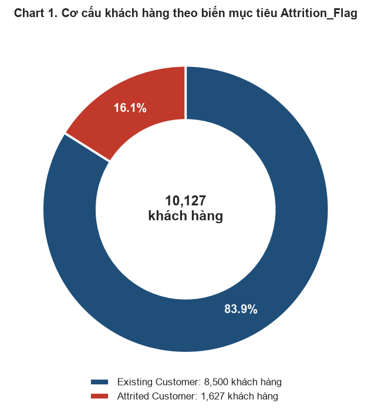
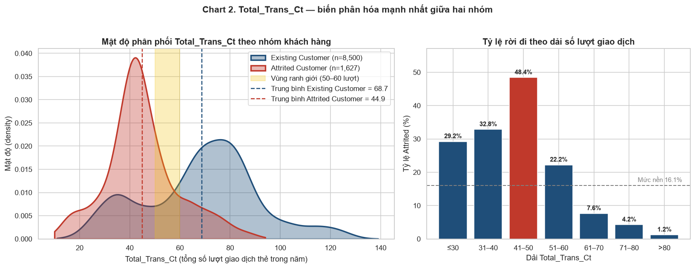
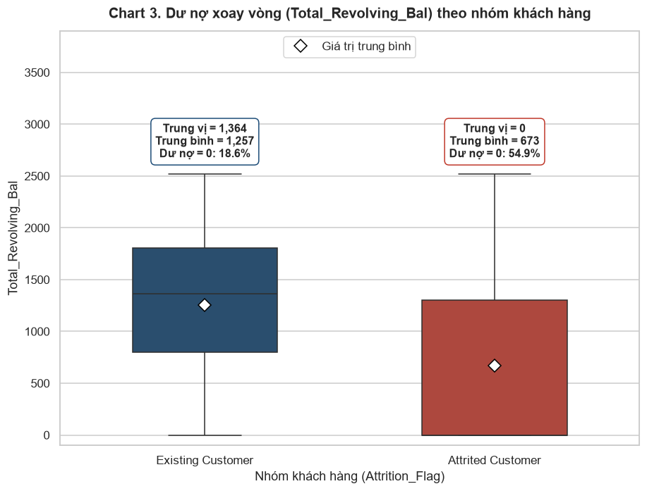
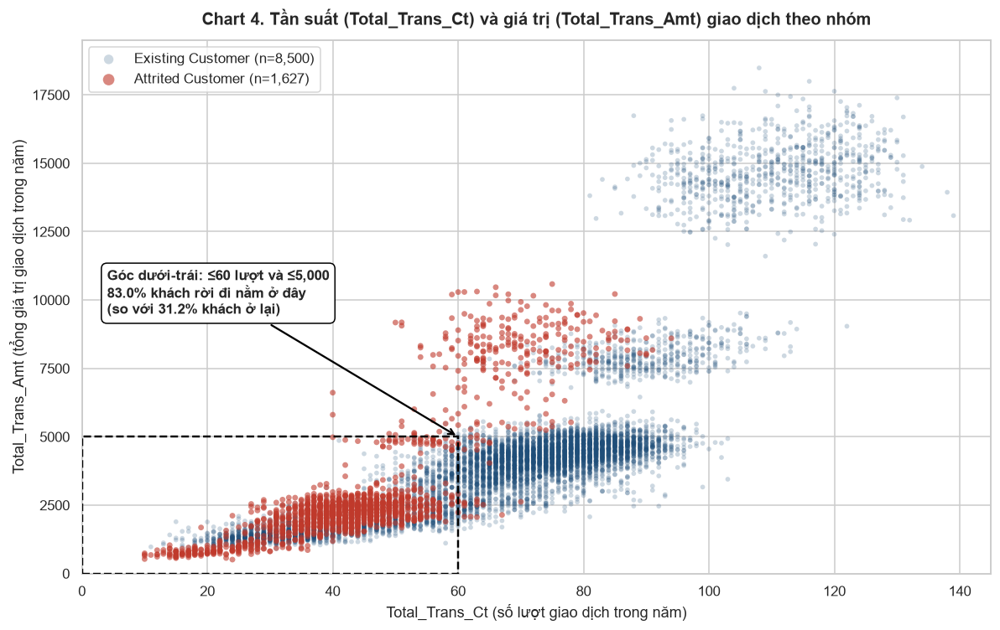
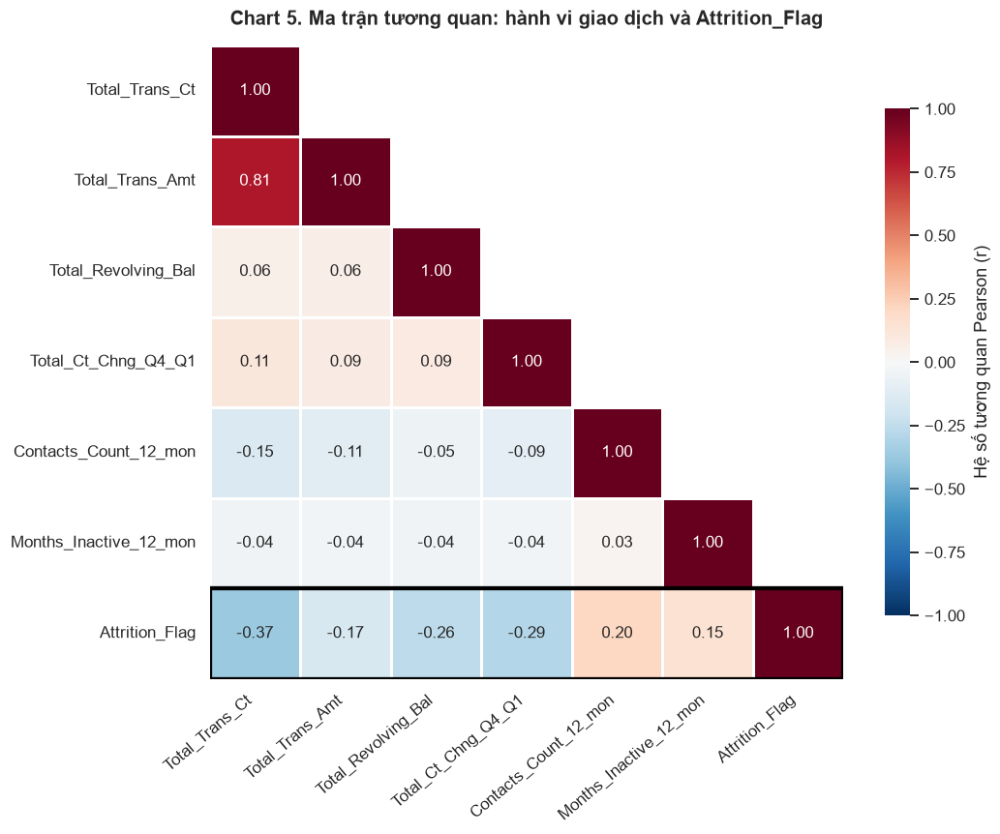

# 📊 Credit Card Customer Churn Analysis & Prediction (ADY201m)

[](https://www.python.org/)
[](https://www.microsoft.com/sql-server)
[](LICENSE)
[]()

> **Dự án:** Phân Tích & Dự Đoán Hành Vi Rời Bỏ Dịch Vụ Thẻ Tín Dụng  
> **Mã môn học:** ADY201m - Advanced Data Analytics  
> **Nền tảng quản lý mã nguồn:** GitHub Collaboration & Version Control  

---

## 📑 Mục lục (Table of Contents)
- [1. Tổng quan dự án (Project Overview)](#1-tổng-quan-dự-án-project-overview)
- [2. Vấn đề kinh doanh (Problem Statement)](#2-vấn-đề-kinh-doanh-problem-statement)
- [3. Mô tả tập dữ liệu (Dataset Description & Source)](#3-mô-tả-tập-dữ-liệu-dataset-description--source)
- [4. Thành viên nhóm & Phân công trách nhiệm (Team Collaboration)](#4-thành-viên-nhóm--phân-công-trách-nhiệm-team-collaboration)
- [5. Cấu trúc thư mục dự án (Project Structure)](#5-cấu-trúc-thư-mục-dự-án-project-structure)
- [6. Công cụ & Thư viện sử dụng (Tools & Technologies)](#6-công-cụ--thư-viện-sử-dụng-tools--technologies)
- [7. Tóm tắt kết quả đã thực hiện (Summary of Completed Work)](#7-tóm-tắt-kết-quả-đã-thực-hiện-summary-of-completed-work)
  - [Giai đoạn 1: Kiểm toán và Tiền xử lý dữ liệu (Data Preprocessing)](#giai-đoạn-1-kiểm-toán-và-tiền-xử-lý-dữ-liệu-data-preprocessing)
  - [Giai đoạn 2: Thiết kế CSDL & Nạp dữ liệu quan hệ (SQL Data Architecture)](#giai-đoạn-2-thiết-kế-csdl--nạp-dữ-liệu-quan-hệ-sql-data-architecture)
  - [Giai đoạn 3: Khai phá dữ liệu chuyên sâu bằng T-SQL (EDA with T-SQL)](#giai-đoạn-3-khai-phá-dữ-liệu-chuyên-sâu-bằng-t-sql-eda-with-t-sql)
- [8. Hình ảnh & Trực quan hóa nổi bật (Key Visualizations)](#8-hình-ảnh--trực-quan-hóa-nổi-bật-key-visualizations)
- [9. Lịch sử đóng góp phiên bản (Version Control & Evidence of Contributions)](#9-lịch-sử-đóng-góp-phiên-bản-version-control--evidence-of-contributions)
- [10. Hướng dẫn chạy dự án (How to Run)](#10-hướng-dẫn-chạy-dự-án-how-to-run)
- [11. Kế hoạch giai đoạn tiếp theo (Roadmap to Machine Learning)](#11-kế-hoạch-giai-đoạn-tiếp-theo-roadmap-to-machine-learning)

---

## 1. Tổng quan dự án (Project Overview)
Trong ngành dịch vụ tài chính - ngân hàng, chi phí để thu hút một khách hàng mở thẻ tín dụng mới cao gấp 5 đến 7 lần so với chi phí duy trì một khách hàng hiện hữu. Do đó, việc chủ động nhận diện sớm các dấu hiệu suy giảm mức độ tương tác và dự đoán nguy cơ khách hàng hủy dịch vụ (*Customer Churn*) đóng vai trò sống còn trong việc tối ưu hóa doanh thu và giữ chân khách hàng.

Dự án này ứng dụng quy trình phân tích dữ liệu toàn diện từ **Làm sạch dữ liệu (Data Cleaning)**, **Thiết kế & Khai phá dữ liệu quan hệ bằng T-SQL (SQL Server)**, tiến tới xây dựng các mô hình **Học máy dự đoán (Machine Learning)**.

> 📌 **Ghi chú tiến độ hiện tại:** Dự án đã hoàn tất trọn vẹn **Giai đoạn Tiền xử lý dữ liệu và Giai đoạn Khai phá nâng cao bằng T-SQL (SQL Phase Completed)**.

---

## 2. Vấn đề kinh doanh (Problem Statement)
Ngân hàng đang đối mặt với bài toán sụt giảm số lượng chủ thẻ tín dụng đang hoạt động:
- **Tỉ lệ rời bỏ thực tế (Base Churn Rate):** Chiếm khoảng **16,07%** tổng số khách hàng.
- **Thách thức kinh doanh:**
  1. Thiếu cơ chế phát hiện sớm sự suy giảm tương tác của khách hàng trước khi họ quyết định hủy thẻ.
  2. Các chiến dịch giữ chân khách hàng trước đây dàn trải, không có tiêu chí phân nhóm rủi ro rõ ràng, gây lãng phí chi phí tiếp thị.
  3. Cần tìm ra các chỉ số hành vi then chốt (như số lượt giao dịch `Total_Trans_Ct`, mức biến động chi tiêu `Total_Ct_Chng_Q4_Q1`, dư nợ xoay vòng `Total_Revolving_Bal`) để xây dựng thang điểm cảnh báo sớm (*Risk Scoring*).

---

## 3. Mô tả tập dữ liệu (Dataset Description & Source)
* **Nguồn dữ liệu:** Bộ dữ liệu [Credit Card Customers Dataset](https://www.kaggle.com/datasets/sakshigoyal7/credit-card-customers) trên Kaggle.
* **Quy mô:** 10.127 bản ghi (dòng) tương ứng với 10.127 khách hàng.
* **Số trường thông tin:**
  * **Tệp thô (`BankChurners.csv`):** 23 thuộc tính (gồm 21 thuộc tính gốc và 2 cột phân loại Naive Bayes được tác giả dữ liệu tạo sẵn cần loại bỏ).
  * **Tệp sạch (`BankChurners_clean.csv`):** 21 thuộc tính chuẩn hóa, loại bỏ hoàn toàn 2 cột dư thừa và mã hóa `Attrition_Flag` thành dạng nhị phân (`0`: Khách hàng ở lại - *Existing Customer*, `1`: Khách hàng rời bỏ - *Attrited Customer*).

### Các nhóm biến chính:
| Nhóm biến | Danh sách thuộc tính | Diễn giải nghiệp vụ |
| :--- | :--- | :--- |
| **Định danh & Trạng thái** | `CLIENTNUM`, `Attrition_Flag` | Mã khách hàng duy nhất và biến mục tiêu đo lường rời bỏ |
| **Nhân khẩu học** | `Customer_Age`, `Gender`, `Dependent_count`, `Education_Level`, `Marital_Status`, `Income_Category` | Đặc điểm cá nhân, học vấn, gia đình và thu nhập hàng năm |
| **Đặc tính thẻ & Tài khoản** | `Card_Category`, `Months_on_book`, `Total_Relationship_Count` | Hạng thẻ (Blue/Silver/Gold/Platinum), thâm niên gắn bó, số sản phẩm mở tại ngân hàng |
| **Mức độ tương tác** | `Months_Inactive_12_mon`, `Contacts_Count_12_mon` | Số tháng không có giao dịch và số lần khách hàng gọi lên tổng đài trong 12 tháng qua |
| **Hành vi tài chính & Giao dịch** | `Credit_Limit`, `Total_Revolving_Bal`, `Avg_Open_To_Buy`, `Total_Amt_Chng_Q4_Q1`, `Total_Trans_Amt`, `Total_Trans_Ct`, `Total_Ct_Chng_Q4_Q1`, `Avg_Utilization_Ratio` | Hạn mức thẻ, dư nợ tín dụng, tổng số tiền và số lượt giao dịch trong năm, tỉ lệ biến thiên Q4 so với Q1 |

---

## 4. Thành viên nhóm & Phân công trách nhiệm (Team Collaboration)

| STT | Họ và Tên | Vai trò chính | Nhiệm vụ chi tiết được giao & Đóng góp |
| :---: | :--- | :--- | :--- |
| 1 | **Tống Việt Thảo** *(Leader)* | **Project Lead & Data Architecture** | • Khởi tạo và quản lý kho lưu trữ GitHub, thiết lập phân nhánh và luồng làm việc Git.<br>• Xây dựng cấu trúc dự án chuẩn (`data/`, `src/`, `reports/`).<br>• Thiết lập quy chuẩn tài liệu (`README.md`, `.gitignore`).<br>• Thu thập, kiểm tra tính toàn vẹn của tệp dữ liệu thô ban đầu.<br>• Điều phối tiến độ nhóm và tổng hợp báo cáo. |
| 2 | **Nguyễn Văn Kiên** | **Data Cleaning & Preprocessing Specialist** | • Thực hiện quy trình kiểm toán dữ liệu (Data Audit) trên Jupyter Notebook (`data_clean.ipynb`).<br>• Xử lý triệt để 2 cột Naive Bayes dư thừa.<br>• Phân tích và quản lý giá trị `Unknown` trong các biến danh mục.<br>• Chuẩn hóa kiểu dữ liệu số thực/số nguyên và xuất tệp dữ liệu sạch `BankChurners_clean.csv`. |
| 3 | **Nguyễn Anh Tới** | **Database & SQL Engineer** | • Thiết kế lược đồ cơ sở dữ liệu quan hệ chuẩn hóa trong SQL Server.<br>• Viết kịch bản T-SQL `taidulieu.sql` khởi tạo bảng `Customers` và `Card_Activity` liên kết khóa ngoại.<br>• Chuyển đổi và nạp 10.127 bản ghi từ bảng Staging sang hệ thống bảng quan hệ.<br>• Kiểm tra tính toàn vẹn dữ liệu (Data Integrity) và khóa chính/ngoại. |
| 4 | **Nguyễn Xuân Đạo** | **SQL Data Analyst & Churn Modeler** | • Xây dựng bộ truy vấn T-SQL chuyên sâu (`khaiphadulieu.sql`) giải quyết các câu hỏi kinh doanh Q0 - Q4.<br>• Phân tích thống kê mô tả (Mean, Median với `PERCENTILE_CONT`, Min, Max) giữa nhóm Churn và Non-Churn.<br>• Khảo sát tính phi tuyến của biến `Total_Trans_Ct` và kiểm định phân tầng (Z-score, tương tác giới tính).<br>• Thiết kế mô hình chấm điểm rủi ro `Risk_Score` đo lường Precision, Recall và Lift. |

---

## 5. Cấu trúc thư mục dự án (Project Structure)
Kho lưu trữ được tổ chức theo tiêu chuẩn quản lý dự án khoa học dữ liệu hiện đại, phân tách rõ ràng giữa dữ liệu, mã nguồn và báo cáo:

```text
ADY201m-BankChurn-Analysis/
│
├── .gitignore                          # Cấu hình bỏ qua tệp tạm, cache, checkpoints
├── README.md                           # Tài liệu tổng quan dự án và minh chứng đóng góp
│
├── data/                               # Quản lý toàn bộ tệp dữ liệu dự án
│   ├── raw/
│   │   └── BankChurners.csv            # Tệp dữ liệu thô gốc từ Kaggle (23 cột, 10.127 dòng)
│   └── processed/
│       └── BankChurners_clean.csv      # Tệp dữ liệu đã làm sạch & chuẩn hóa (21 cột, 10.127 dòng)
│
├── src/                                # Toàn bộ mã nguồn thực thi của dự án
│   ├── notebooks/                      # Sổ tay phân tích tương tác Python (Jupyter Notebooks)
│   │   ├── data_clean.ipynb            # Tiền xử lý, kiểm toán ngoại lai và làm sạch dữ liệu
│   │   └── ADY201m_BankChurners.ipynb  # Khám phá dữ liệu EDA và trực quan hóa phân phối
│   └── sql/                            # Kịch bản cơ sở dữ liệu quan hệ T-SQL
│       ├── taidulieu.sql               # Tạo Schema quan hệ (Customers, Card_Activity) & nạp dữ liệu
│       └── khaiphadulieu.sql           # Truy vấn phân tích kinh doanh chuyên sâu (Q0 - Q4 & Phụ lục A)
│
└── reports/                            # Báo cáo tổng hợp và tài liệu trực quan hóa
    ├── documentation/
    │   └── phase_sql_findings.md       # Báo cáo chi tiết các phát hiện nghiệp vụ giai đoạn SQL
    └── figures/                        # Biểu đồ và hình ảnh phân tích trực quan
        ├── chart1_target_distribution.png     # Phân bố biến mục tiêu Attrition_Flag
        ├── chart2_trans_ct_distribution.png   # Phân phối tần suất giao dịch theo nhóm Churn
        ├── chart3_revolving_bal_comparison.png # So sánh dư nợ xoay vòng giữa 2 nhóm
        ├── chart4_trans_ct_vs_amt.png         # Mối quan hệ giữa Số lượng và Giá trị giao dịch
        └── chart5_correlation_heatmap.png     # Ma trận hệ số tương quan giữa các thuộc tính
```

---

## 6. Công cụ & Thư viện sử dụng (Tools & Technologies)
* **Ngôn ngữ lập trình & Môi trường:** Python 3.9+, Jupyter Notebook.
* **Thư viện xử lý dữ liệu:** `pandas`, `numpy`.
* **Thư viện trực quan hóa:** `matplotlib`, `seaborn`.
* **Hệ quản trị cơ sở dữ liệu:** Microsoft SQL Server (T-SQL 2016 SP1 trở lên), Azure Data Studio / SQL Server Management Studio (SSMS).
* **Quản trị phiên bản & Cộng tác:** Git, GitHub.

---

## 7. Tóm tắt kết quả đã thực hiện (Summary of Completed Work)

### Giai đoạn 1: Kiểm toán và Tiền xử lý dữ liệu (Data Preprocessing)
1. Kiểm tra 10.127 dòng, xác nhận không có dòng trùng lặp hoàn toàn (`duplicated = 0`).
2. Phát hiện và xử lý giá trị thiếu dạng nhãn văn bản `'Unknown'`:
   - `Education_Level`: 1.519 dòng (15,00%).
   - `Income_Category`: 1.112 dòng (10,98%).
   - `Marital_Status`: 749 dòng (7,40%).
   - Quyết định giữ nguyên nhóm `'Unknown'` như một phân lớp riêng vì tỉ lệ rời bỏ của nhóm này (~16,8% - 17,2%) tương đồng với tỉ lệ nền.
3. Loại bỏ 2 cột phân loại Naive Bayes ở cuối bảng gốc nhằm tránh hiện tượng rò rỉ dữ liệu (*Data Leakage*).
4. Mã hóa biến mục tiêu `Attrition_Flag`: `Existing Customer` $\rightarrow$ `0`, `Attrited Customer` $\rightarrow$ `1`.

### Giai đoạn 2: Thiết kế CSDL & Nạp dữ liệu quan hệ (SQL Data Architecture)
Tách bảng phẳng thành mô hình quan hệ 3NF tối ưu trong `taidulieu.sql`:
* Bảng `dbo.Customers`: Lưu trữ hồ sơ nhân khẩu và trạng thái khách hàng (`CLIENTNUM` làm Primary Key).
* Bảng `dbo.Card_Activity`: Lưu trữ lịch sử giao dịch và tài chính (`Activity_ID` Identity PK, `CLIENTNUM` làm Foreign Key).
* Nạp thành công toàn bộ 10.127 bản ghi vào cả 2 bảng đảm bảo tính toàn vẹn khóa ngoại.

### Giai đoạn 3: Khai phá dữ liệu chuyên sâu bằng T-SQL (EDA with T-SQL)
Thực hiện kịch bản phân tích hoàn chỉnh trong `khaiphadulieu.sql`:
1. **Churn nền (Base Churn):** $1.627 / 10.127 = 16,07\%$ (tỉ lệ xấp xỉ 1 : 5).
2. **Sự khác biệt về tần suất giao dịch (`Total_Trans_Ct`):**
   - Khách hàng rời bỏ có số lượt giao dịch trung bình **44,93** lượt/năm so với **68,67** lượt/năm ở khách hàng duy trì (giảm **~35%**).
   - Trung vị số lượt giao dịch ở nhóm rời bỏ là **43** lượt, so với **67** lượt ở nhóm ở lại.
3. **Mối quan hệ phi tuyến tính:**
   - Tỉ lệ rời bỏ tập trung cao đột biến ở dải **41 - 50 lượt giao dịch/năm** (đạt **48,40%**).
   - Khi khách hàng đạt từ **61 giao dịch trở lên**, tỉ lệ rời bỏ tụt dốc chỉ còn **3,88%**.
4. **Phân tầng nhân khẩu học & Tương tác giới tính:**
   - Ở nhóm giao dịch ít ($\le 50$ lượt), khách hàng nữ có tỉ lệ rời bỏ cao hơn hẳn nam (**49,83%** so với **27,37%**).
   - Ở nhóm giao dịch tích cực ($\ge 61$ lượt), nữ lại gắn bó hơn nam (**2,42%** so với **5,82%**).
5. **Thang đo rủi ro đa biến (Risk Scoring Engine):**
   - Xây dựng hệ thống 6 điều kiện cảnh báo rủi ro. Khi áp dụng tiêu chí `Risk_Score >= 4`, đạt:
     - **Precision:** `76,73%`
     - **Recall:** `53,72%`
     - **Lift:** `4,77x` (khả năng phát hiện đúng khách rời bỏ gấp gần 4,8 lần so với ngẫu nhiên).

---

## 8. Hình ảnh & Trực quan hóa nổi bật (Key Visualizations)

Các biểu đồ phân tích được trích xuất trực tiếp từ quá trình phân tích khám phá trong thư mục `reports/figures/`:

| Biểu đồ | Mô tả & Ý nghĩa phân tích |
| :--- | :--- |
|  | **Phân bố biến mục tiêu Attrition_Flag:** Thể hiện rõ sự mất cân bằng giữa nhóm khách hàng ở lại (83,93%) và nhóm rời bỏ (16,07%). |
|  | **Phân phối số lượt giao dịch (Total_Trans_Ct):** Nhóm rời bỏ phân bố tập trung ở vùng 30 - 50 giao dịch, hoàn toàn tách biệt với đỉnh giao dịch của khách hàng duy trì (60 - 90 giao dịch). |
|  | **So sánh dư nợ xoay vòng (Total_Revolving_Bal):** Khách hàng rời bỏ có dư nợ xoay vòng cực kỳ thấp hoặc bằng 0, phản ánh trạng thái ngừng sử dụng thẻ trước khi hủy. |
|  | **Tần suất vs Giá trị giao dịch:** Mối tương quan đồng thuận mạnh giữa số lượt và số tiền chi tiêu. Phân cụm khách hàng rời bỏ tập trung ở góc trái dưới. |
|  | **Ma trận hệ số tương quan:** Xác định các thuộc tính có mối tương quan mạnh nhất với hành vi sử dụng thẻ làm đầu vào cho mô hình máy học. |

---

## 9. Lịch sử đóng góp phiên bản (Version Control & Evidence of Contributions)

Dự án tuân thủ nghiêm ngặt quy trình quản lý phiên bản với Git & GitHub, phân chia nhiệm vụ và commit rõ ràng theo từng thành viên:

| Commit Hash / Tag | Tác giả (Author) | Thông điệp commit (Commit Message) | Nội dung đóng góp cụ thể |
| :--- | :--- | :--- | :--- |
| `commit #1` | **Tống Việt Thảo** | `chore: initialize repository structure and .gitignore` | Khởi tạo cấu trúc các thư mục `data/`, `src/`, `reports/` và thiết lập file cấu hình `.gitignore`. |
| `commit #2` | **Tống Việt Thảo** | `feat(data): setup raw dataset BankChurners.csv` | Thu thập và nạp tệp dữ liệu thô từ Kaggle vào thư mục `data/raw/`. |
| `commit #3` | **Nguyễn Văn Kiên** | `feat(cleaning): implement data audit and preprocessing pipeline` | Viết kịch bản kiểm toán dữ liệu và làm sạch trong `src/notebooks/data_clean.ipynb`. |
| `commit #4` | **Nguyễn Văn Kiên** | `feat(data): export cleaned dataset BankChurners_clean.csv` | Xuất và lưu trữ bộ dữ liệu sạch 21 thuộc tính vào `data/processed/`. |
| `commit #5` | **Nguyễn Anh Tới** | `feat(sql): create schema and import data in taidulieu.sql` | Thiết kế CSDL quan hệ chuẩn hóa và nạp dữ liệu vào bảng `Customers` & `Card_Activity`. |
| `commit #6` | **Nguyễn Xuân Đạo** | `feat(sql): conduct advanced exploratory analysis in khaiphadulieu.sql` | Xây dựng bộ truy vấn T-SQL giải quyết các bài toán Q0 - Q4 và Phụ lục A. |
| `commit #7` | **Tống Việt Thảo** | `feat(reports): extract exploratory figures and write SQL findings` | Trích xuất bộ 5 biểu đồ trực quan hóa vào `reports/figures/` và viết báo cáo tóm tắt phát hiện SQL. |
| `commit #8` | **Cả nhóm** | `docs: finalize comprehensive README documentation and collaboration guide` | Hoàn thiện toàn bộ tài liệu dự án `README.md` theo yêu cầu đồ án. |

---

## 10. Hướng dẫn chạy dự án (How to Run)

### Yêu cầu cài đặt
* Cài đặt **Python 3.9+** với các thư viện:
  ```bash
  pip install pandas numpy matplotlib seaborn jupyter
  ```
* Cài đặt **Microsoft SQL Server** (bản Developer/Express) và **SSMS** hoặc tiện ích SQL trên VS Code.

### Các bước thực hiện
1. **Khám phá và Tiền xử lý dữ liệu:**
   - Mở Jupyter Notebook: `jupyter notebook`
   - Chạy tuần tự notebook `src/notebooks/data_clean.ipynb` để tái hiện quá trình làm sạch dữ liệu.
2. **Khởi tạo và nạp cơ sở dữ liệu SQL:**
   - Kết nối với SQL Server Management Studio (SSMS).
   - Mở và thực thi kịch bản `src/sql/taidulieu.sql` để tạo cấu trúc cơ sở dữ liệu `Bank_Churn` và nạp 2 bảng `Customers`, `Card_Activity`.
3. **Chạy các truy vấn phân tích nghiệp vụ:**
   - Mở kịch bản `src/sql/khaiphadulieu.sql`.
   - Thực thi từng khối truy vấn (từ `Q0` đến `Q4` và `Phụ lục A`) để xem các bảng dữ liệu thống kê tham chiếu.

---

## 11. Kế hoạch giai đoạn tiếp theo (Roadmap to Machine Learning)
Sau khi hoàn tất giai đoạn phân tích trên SQL, nhóm dự kiến triển khai các bước tiếp theo:
1. **Feature Engineering:** Tạo thêm các đặc trưng phái sinh từ hành vi giao dịch (tương tác giới tính x số lượt giao dịch, tỉ lệ nợ trên hạn mức).
2. **Xử lý dữ liệu mất cân bằng:** Áp dụng kỹ thuật SMOTE hoặc trọng số lớp (*class weights*).
3. **Xây dựng mô hình phân loại:** Thử nghiệm Logistic Regression (Baseline), Random Forest, XGBoost và LightGBM.
4. **Đánh giá & Triển khai:** Tối ưu hóa ngưỡng phân loại dựa trên PR-AUC, xây dựng danh sách cảnh báo sớm tự động cho bộ phận chăm sóc khách hàng của ngân hàng.
